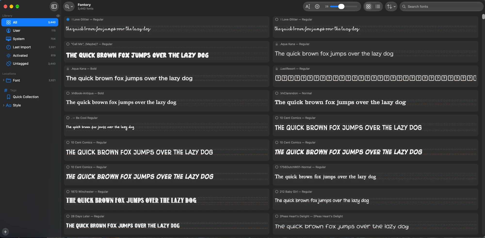

# Fontory

**A fast, native font manager for macOS, built for very large libraries.**

Fontory manages the fonts you already have, wherever they live, including on an external drive. It indexes them once, then lets you browse, preview, search, tag and activate tens of thousands of fonts without lag. Activated fonts show up straight away in Adobe apps, Pixelmator Pro and any other Mac app, with no restart.

It was written for a designer with about 20,000 fonts on an external drive, after other font managers became too slow at that size.



[](https://github.com/trinknx/fontory/releases/latest)


[](LICENSE)

---

## Contents

- [Why Fontory](#why-fontory)
- [Features](#features)
- [Install](#install)
- [Getting started](#getting-started)
- [Keyboard shortcuts](#keyboard-shortcuts)
- [Your data](#your-data)
- [Building from source](#building-from-source)
- [Project layout](#project-layout)
- [Testing](#testing)
- [Releasing](#releasing)
- [Roadmap](#roadmap)
- [Contributing](#contributing)
- [Support the project](#support-the-project)
- [License](#license)

---

## Why Fontory

- **Fast at 20k+ fonts.** Everything the browser shows comes from a SQLite index with full-text search, so font files are only opened for the cells on screen. Scrolling, filtering and searching stay smooth at that size.
- **Your files stay put.** Fontory never copies or moves fonts into a managed folder. You add folders or files, and they stay where they are.
- **Built for external drives.** Locations are identified by volume UUID and relative path, not by mount path. Unplug the drive and its fonts go offline but keep their tags and notes. Plug it back in, even at a different mount point like `/Volumes/Fonts 1`, and the fonts you had on are activated again.
- **Hot activation.** Fonts are registered for your login session through CoreText, so other apps update their font menus without restarting.
- **Native and private.** Swift, SwiftUI and AppKit, with no third-party dependencies, no account, no network access and no telemetry.

## Features

### Library and scanning

- Add whole folders or individual files. Subfolders of each location appear in the sidebar.
- Background, incremental scanning: only new, changed or deleted files are processed, and the UI stays usable while it runs.
- Folder watching picks up changes while a drive is mounted.
- Formats: `.ttf`, `.otf`, `.ttc`, `.otc`, `.dfont`, `.woff` and `.woff2`, plus PostScript Type 1 where CoreText supports it.
- Relink a moved location, reveal fonts in Finder, and show or hide system fonts.

### Browse and preview

- Grid (⌘1) and list grouped by family (⌘3). List columns can be reordered, resized and hidden.
- Zoom with pinch, ⌘+ / ⌘− / ⌘0 or the toolbar slider. Cells and preview size scale together, and the columns reflow to fit the window.
- Custom preview text, presets and a smart sample that picks text for the font's script (Vietnamese, Cyrillic, CJK, Arabic and more).
- Size, tracking, alignment, text and background colours, light and dark themes, and metric guides (baseline, x-height, cap height, ascender, descender).
- Sort by name, family, weight, style, date added, last activated or random.
- A family page (⌘I) with these tabs:
  - **Styles:** the family's styles.
  - **Text:** body text in the chosen style.
  - **Characters:** a glyph grid with script and category filters, search by name, character or code point, and unmapped glyphs in glyph order. Copy a glyph as an image or as SVG code, or drag it out as SVG.
  - **Features:** every OpenType feature with a live toggle and a script/language picker, plus Apple Advanced Typography features.
  - **Variables:** axis sliders, named instances, optical sizing and a copy of the `font-variation-settings` CSS.
- **GSUB rule inspection.** Expand any substitution feature (ss01, liga, salt, swsh…) to see its actual `input → output` rules. Rules that only fire next to other letters or in a certain language are flagged as "in context only". Drag a glyph into Pixelmator Pro to get an editable vector shape, or copy it as a high-resolution PNG.
- Colour fonts (COLR, sbix and OpenType-SVG) are previewed in colour.

### Organize

- Nested tags (`Projects/Client`), assigned by drag and drop or from the multi-tag panel (⌘T, keyboard-driven, fuzzy search).
- ⌘-click to combine tags, ⌥-click to invert one.
- Smart tags built from saved filters.
- Automatic style views: Serif, Sans, Slab, Script, Mono, Display and Symbol.
- Quick Collection (⌘J): a shortlist that persists between launches and can be saved as a tag.
- Searchable notes on every font.

### Search and filter

- Full-text search with exact, prefix and suffix matching, scoped to family, foundry, designer or notes.
- Tag syntax: `#tag` and `#!tag` (not tagged), combined with AND.
- Filters: format, outline type (TrueType, CFF, CFF2), weight, width, italic, variable, colour or bitmap, language and script, x-height, figure style, supported OpenType features, online or offline, activation state, and "supports every character in the preview text".
- Partial families: a filter shows only the styles in a family that match.

### Activation

- Click to activate. Choose permanent ("on") or temporary, for one font, a selection, a family or a whole tag.
- Permanent activations are restored at launch, at login and when a drive is plugged back in. Temporary activations end when Fontory quits.
- Fonts that macOS or Font Book already has active are shown as active and read-only.
- A menu bar item and launch at login keep activations alive after the window closes.

### Tools

- **Compare (⌥⌘K):** overlay two fonts A/B, step through your Quick Collection, and view glyph outlines.
- **Pairing Studio (⌘K opens the selection in Layouts):** try candidate fonts on each block of a layout and cycle through them.
- **Layouts:** book, magazine, column, quote, character and waterfall templates with editable text blocks. Templates are plain files you can edit outside the app. Export to PDF or print.
- **Duplicates (⇧⌘D):** finds exact copies (by content hash) and near copies (same PostScript name and version), auto-selects candidates by format or location, then removes them from the library or moves them to the Trash. Can skip duplicates on future imports.
- **Export (⇧⌘E):** copies the font files of a selection, tag, family or the Quick Collection to a folder.
- **Family Editor:** rename, merge or split families without touching the font files. Every change can be undone.
- **Backup and restore:** tags, notes, families and (optionally) activation state go into JSON backups. A backup is made automatically when Fontory quits, kept for 10 days, and can also be made by hand.

## Install

### Requirements

- macOS 14 Sonoma or later
- A Mac with Apple Silicon

### Download

1. Download `Fontory-<version>.dmg` (or the `.zip`) from the [latest release](https://github.com/trinknx/fontory/releases/latest).
2. Open it and drag **Fontory** into **Applications**.
3. Fontory is ad-hoc signed, not notarized, so macOS blocks it the first time. Run this once in Terminal:

   ```bash
   xattr -dr com.apple.quarantine /Applications/Fontory.app
   ```

   Or right-click Fontory in Applications and choose **Open**.

Every release includes a `SHA256SUMS.txt` to check your download against:

```bash
shasum -a 256 -c SHA256SUMS.txt
```

### Updating

Quit Fontory, replace the app in Applications, then run the `xattr` command again. Your library, tags and notes are kept.

## Getting started

1. **Add fonts.** Choose **File → Add Fonts…** (⌘O) and pick a folder or font files. Fontory scans in the background and shows fonts as they are found. The first scan of a large external drive can take a while; later launches only look at what changed.
2. **Preview.** Type your own text in the toolbar, zoom with pinch or ⌘+ / ⌘−, and press ⌘I to open a family's page.
3. **Activate.** Click a font's activation icon. It appears in Photoshop, Illustrator, InDesign, Pixelmator Pro and other apps without a restart.
4. **Organize.** Select fonts and press ⌘T to tag them, or ⌘J to add them to the Quick Collection.
5. **Settings** (⌘,) has launch at login, the menu bar option, system fonts, locations, duplicate handling and backups.

## Keyboard shortcuts

| Shortcut | Action |
|---|---|
| ⌘O | Add fonts |
| ⌘1 | View as grid |
| ⌘3 | View as list |
| ⌘+ / ⌘− / ⌘0 | Zoom in / zoom out / actual size |
| ⌘I | Show family |
| ⌘[ | Back |
| ⌥⌘P | Preview options |
| ⌘T | Tags panel |
| ⌘J | Add to or remove from Quick Collection |
| ⌘K | Open the selection in Layouts (Pairing Studio) |
| ⌥⌘K | Compare fonts |
| ⇧⌘E | Export fonts |
| ⇧⌘D | Find duplicates |
| ⌘P | Print (Layouts window) |
| ⌘C | Copy the selected glyph (Characters and Features tabs) |

## Your data

Fontory reads your font files and never changes them. Everything it records lives in your user Library:

| What | Where |
|---|---|
| Index, tags, notes and settings (SQLite) | `~/Library/Application Support/Fontory/` |
| Automatic and manual backups (JSON) | `~/Library/Application Support/Fontory/Backups/` |
| Your layouts and Pairing Studio documents | `~/Library/Application Support/Fontory/Layouts/` |
| Layout templates (editable files) | `~/Library/Application Support/Fontory/Templates/` |
| Preferences | the `local.fontory.app` defaults domain |

Fontory makes no network requests.

To remove Fontory completely, quit it, delete the app, then delete `~/Library/Application Support/Fontory`.

## Building from source

### Requirements

- Xcode 26 or later (Swift 6, macOS 26 SDK; the app still runs on macOS 14)
- [XcodeGen](https://github.com/yonaskolb/XcodeGen): `brew install xcodegen`

The Xcode project is generated from `project.yml` and is not committed.

### Build and run

```bash
git clone https://github.com/trinknx/fontory.git
```

```bash
cd fontory
```

```bash
xcodegen generate
```

```bash
open Fontory.xcodeproj
```

Then run the **Fontory** scheme. To build from the command line instead:

```bash
xcodebuild -project Fontory.xcodeproj -scheme Fontory -configuration Debug -derivedDataPath build build
```

The app is at `build/Build/Products/Debug/Fontory.app`.

### Release build

```bash
scripts/build-release.sh
```

This builds an ad-hoc signed Release app and puts `Fontory-<version>.zip`, `Fontory-<version>.dmg` and `SHA256SUMS.txt` into `dist/`. Pass a version (`scripts/build-release.sh 0.4.1`) to override the one in `project.yml`. The build number is the git commit count.

## Project layout

```
App/Fontory/                 the macOS app (SwiftUI + AppKit)
  Views/                     main window, sidebar, grid, detail tabs, settings
  Compare/                   the A/B Compare window
  Layouts/                   the Layouts window and Pairing Studio
  Templates/                 built-in layout templates
  Debug/                     the in-app smoke test
Packages/FontoryCore/        UI-free core library, unit tested
  Sources/FontoryCore/
    Index/                   SQLite index, schema, migrations, FTS5
    Scanner/                 folder walking, CoreText parsing, incremental diff
    Activation/              CTFontManager registration and state
    Volumes/                 mount tracking and volume UUIDs
    Search/                  query parsing, tags, filters
    Preview/  Glyphs/        rendering, glyph images and SVG export
    Features/                OpenType feature inventory, GSUB rule reader
    Layout/  Compare/        layout documents, PDF output, overlay rendering
    Duplicates/ Backup/ Export/
docs/superpowers/            design spec, implementation plans and verification checklists
scripts/build-release.sh     release packaging
.github/workflows/release.yml  builds and publishes a release when a tag is pushed
project.yml                  XcodeGen project definition
```

The design spec, [docs/superpowers/specs/2026-11-23-font-manager-design.md](docs/superpowers/specs/2026-11-23-font-manager-design.md), explains the architecture and the reasoning behind it.

## Testing

Core unit tests (Swift Testing):

```bash
swift test --package-path Packages/FontoryCore
```

Some performance tests generate a synthetic library of 20,000 fonts and check timings, so they can be flaky on a busy machine.

The app also has a smoke test that exercises the real app code against temporary folders and a private pasteboard. It never touches your library, settings or clipboard:

```bash
build/Build/Products/Debug/Fontory.app/Contents/MacOS/Fontory -FontoryOrganizationSmoke
```

It prints `SMOKE PASSED` when every check passes. Hand-test checklists for each feature wave are in `docs/superpowers/verification/`.

## Releasing

1. Set `MARKETING_VERSION` in `project.yml` and commit.
2. Tag and push:

   ```bash
   git tag -a v0.4.1 -m "Fontory 0.4.1"
   ```

   ```bash
   git push origin v0.4.1
   ```

3. The [Release workflow](.github/workflows/release.yml) runs the core tests, builds the app, and publishes a GitHub release with the `.dmg`, `.zip` and checksums. Running the workflow by hand from the Actions tab builds without publishing.

## Roadmap

- **Font Switch:** drop a font onto Photoshop, Illustrator, InDesign, After Effects or Pixelmator Pro to apply it to the current text selection.
- **Auto-activation:** turn on the fonts a document needs when it is opened.
- Developer ID signing and notarization, so the `xattr` step is no longer needed.
- Intel support.

Out of scope: Google Fonts and Adobe Fonts sync, cloud sync of tags (use backups), and the Mac App Store, because Fontory needs unsandboxed access to your font folders.

## Contributing

Bug reports and pull requests are welcome.

- **Bugs:** open an issue with your macOS version, Fontory version (**Fontory → About Fontory**), the steps to reproduce, and the font if you can share it. Many bugs only show up with a particular font.
- **Pull requests:** keep each one focused, add tests in `Packages/FontoryCore/Tests` for core changes, and make sure `swift test` and the smoke test pass.
- **Performance matters.** Changes to the browser, search or scanning must stay smooth with 20,000+ fonts. The grid must never open font files just to read metadata.
- **No new dependencies** without a strong reason. Fontory uses only Apple frameworks and the system SQLite.

## Support the project

Fontory is free and open source. If it saves you time, you can support its development with a USDT donation:

| Network | Address |
|---|---|
| USDT on BNB Smart Chain (BEP20) | `0x7450cf5cfb5e89c62bcaec70102c9e8e48735ba2` |

Send only USDT on the BEP20 network to this address. Tokens sent on another network (such as ERC20 or TRC20) may be lost.

## License

Fontory is released under the [MIT License](LICENSE).

Fontory manages font files but does not include or distribute any fonts. The fonts in your library are covered by their own licences.
